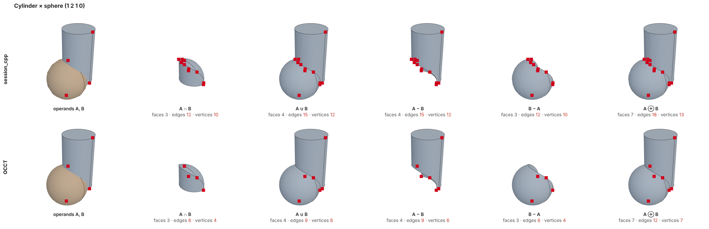
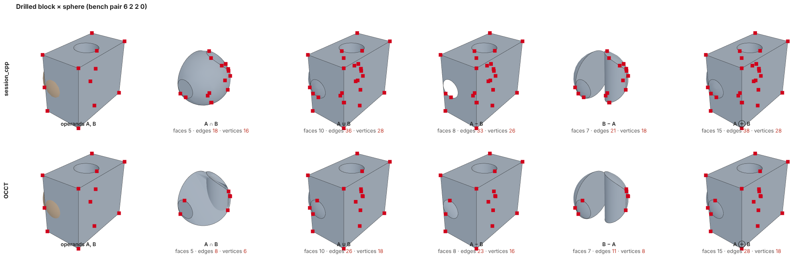
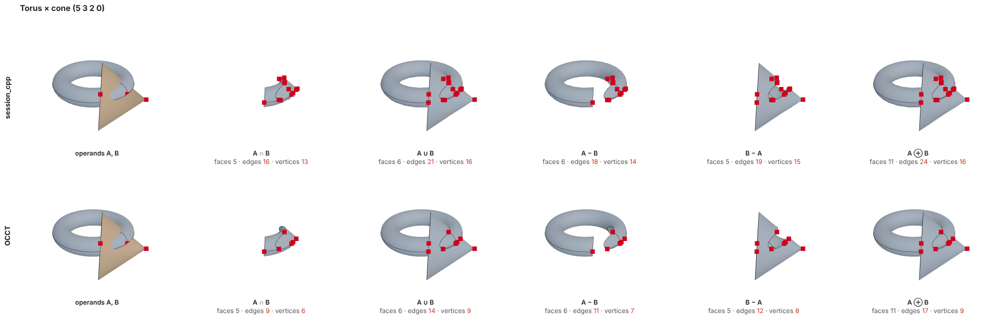
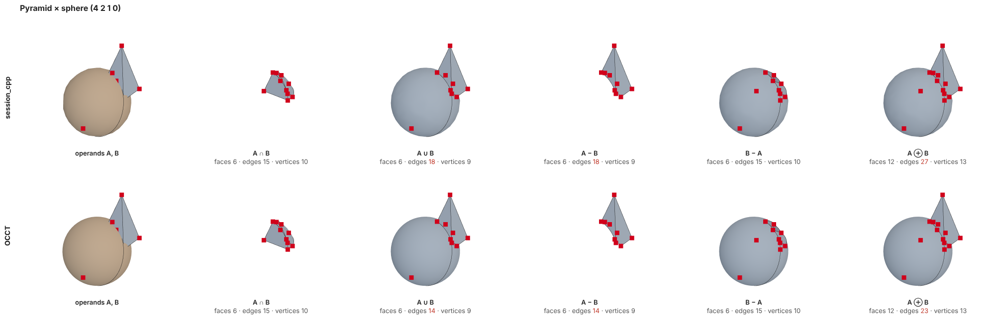
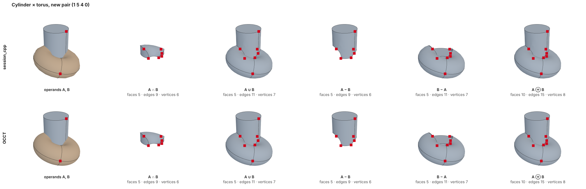
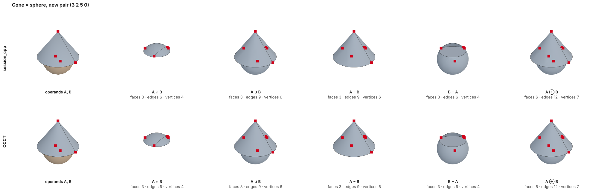
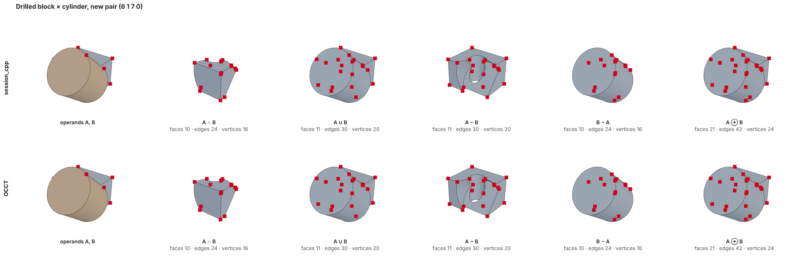

# OCCT against session_cpp on the boolean bench, 2026-11-13

OCCT built from source at `d3056ef80c9668f395da40f5fd7be186cae4501f` (the revision the plan
reads), Release, `TKBO TKPrim TKOffset` and what they need. `occt_bench.cpp` runs the 15 pairs
of `session_cpp/examples/native_boolean_bench.cpp` through `BRepAlgoAPI_Common/Fuse/Cut`: same
generator, sizes and poses; exclusive-or is two cuts and a fuse. Ours is `session_cpp`
`4ca55030` (`docs/validation/2026-11-13-boolean-bench-wp2.txt`). Same machine, 4 cores, one
thread each, a kernel build running beside both.

```bash
cmake -S occt -B occt_build -G Ninja -DCMAKE_BUILD_TYPE=Release -DBUILD_MODULE_Visualization=OFF \
  -DBUILD_MODULE_ApplicationFramework=OFF -DBUILD_MODULE_DataExchange=OFF -DBUILD_MODULE_Draw=OFF \
  -DBUILD_MODULE_DETools=OFF -DUSE_FREETYPE=OFF -DUSE_TK=OFF -DUSE_TCL=OFF -DBUILD_GTEST=OFF
```

```bash
ninja -C occt_build -j2 TKBO TKPrim TKOffset
```

```bash
cmake -S docs/validation/occt_bench -B occt_bench_build -DCMAKE_BUILD_TYPE=Release -DOCCT_BUILD=$PWD/occt_build && cmake --build occt_bench_build
```

`occt_bench_d3056ef8.txt` is its output (best of three runs per operation). `occt_bench.py` is
the same list through the `cadquery-ocp` wheel (OCCT 8.0.1), the first measurement.

## Results: the solids are the same

| | |
| --- | --- |
| Valid results | 75 of 75 on both sides |
| Faces | identical in 75 of 75 rows |
| Faces, edges and vertices | identical in 39 of 75 rows |
| Volume, 30 rows printed to 13 digits on both sides | largest difference 6.3e-9 |
| Volume, the other 45 rows | equal to the six digits ours prints |
| Sum of the 75 volumes | 93.3614 on both sides |

In the other 36 rows ours has more edges and vertices on the same faces. Where a pyramid is not
involved the extra edges and the extra vertices are the same number (3 to 10 per result): edges
that OCCT keeps whole are cut by a vertex in ours. They are all on results with a sphere, cone,
cylinder or torus cut by a curved face or by the drilled hole. Not yet traced to its place in
the code; the candidates are the knot lines of our NURBS sphere, cone and torus, where a
section piece is ended (`split_quad_at_creases`, `quintic_plane_piece`), and seam crossings.
OCCT's surfaces are analytic and have no knot lines. With a pyramid ours has up to five edges
more and at most one vertex more, which fits the collapsed apex edges of our pyramid sides;
also not traced.

The 6e-9 in volume is OCCT's side: its section curves are approximated to 1e-7 and its volume
is Gauss integration to 1e-10, ours is certified to about 1e-10.

## Time

| | OCCT | ours | ratio |
| --- | --- | --- | --- |
| 75 booleans, each from scratch | 6.6 s | 195 s | 30 |
| intersection part per boolean (`BOPAlgo_PaveFiller` / `brep_section::interferences`) | 0.045 s | 1.40 s | 31 |
| building part per boolean (`BOPAlgo_BOP` / partition + select + assemble) | 0.011 s | 1.09 s | 100 |
| volume of the 75 results | 1.2 s | 57 s | 49 |

OCCT per pair: 0.92, 0.70, 0.81, 0.69, 0.73, 0.68, 0.54, 0.52, 0.42, 0.09, 0.08, 0.18, 0.08,
0.12, 0.009 s in the order of the bench list; ours 22.7, 18.7, 12.4, 9.8, 10.6, 18.8, 39.0,
23.8, 21.5, 0.8, 1.4, 11.1, 1.3, 2.6, 0.14 s.

## Where the time goes, and the source on both sides

OCCT's shares are callgrind instruction counts of drilled block against sphere ("6 2 2 0") and
drilled block against torus ("6 5 3 0"); ours are the counters and stack samples of the WP3
profile of the same bench (187.6 s inside `brep_boolean::apply`).

| Stage | OCCT: share, function, file | ours: share, function | The difference in the source |
| --- | --- | --- | --- |
| Finding the section of two faces | 8 to 14 %. `IntPatch_Intersection::Perform` (`TKGeomAlgo/IntPatch`): plane, cylinder, cone and sphere pairs in closed form (`IntPatch_ImpImpIntersection`, `IntAna_QuadQuadGeo`, `IntAna_Curve`: 3.7 % for the sphere and hole), a quadric against any other surface as the zero set of one function of two parameters (`IntPatch_ImpPrmIntersection`: 13 % for box planes against the torus) | `surface_section::intersect` 87 s of 187 s. In "6 2 2 0" `surface_surface_seeds` is 64 % of 39 s, `seed_cell_covered` 42 % (`nurbs_interval::surface_bounds`, `blossom`) | OCCT never searches for a section between quadrics, it writes it down; where it has to search it takes start points from a mesh (`IntPolyh`) and proves nothing. Ours treats every pair as two NURBS in four parameters and proves by interval bounds that no cell of the domain hides a branch. That proof is most of our time on curved pairs |
| Fitting the section curve | 13 to 20 %. `GeomInt_WLApprox::Perform` -> `ApproxInt_KnotTools::BuildKnots`: knots from the curvature of the walked points, C2, 1e-7 | inside `surface_section`: `even_nodes`, `quintic_plane_piece`, `quintic_section` (WP2) | The same idea since WP2. Ours fits to 2e-9, OCCT to 1e-7 |
| Measuring what the fit reached | 25 to 29 %, OCCT's largest single item. `IntTools_FaceFace::ComputeTolReached3d` -> `IntTools_Tools::ComputeTolerance` -> `GeomLib_CheckCurveOnSurface::Perform`, a particle-swarm search (`PSO_Perform`) for the largest distance between curve and pcurve; the result becomes the edge tolerance | `curve_surface_intersection::same_parameter`: 39.9 s of 187 s, 45 102 calls, 34 055 of them on an input already certified in the same boolean (`split::validate` 30 175 calls, `brep_assemble::append_edge` 6 982) | OCCT estimates once per section curve and stores the number on the edge. Ours proves, and proves the same curve again after every face split and again in the assembly. Storing what was reached is WP4b; not asking twice is WP3 |
| Edge against edge, edge against face | 3 to 10 %. `BOPAlgo_PaveFiller::PerformEE`, `PerformEF`: pairs chosen once by a box tree (`BOPDS_Iterator`), results kept as pave blocks and common blocks in `BOPDS_DS` and read by every later stage | `curve_intersection::intersect`: 39.6 s of 187 s on the bench; 669 s of 1006 s in `brep_boolean_test`, where `brep_section::boundary_nodes` makes 9.6 million calls and 9.4 million repeat a pair already done | OCCT intersects a pair once and looks the result up afterwards. Ours intersects again in `boundary_nodes`, `trim_parameters`, `covers`, `compute_spans`, `synchronize`, `equivalent` |
| Building the split faces | 4 to 5 %. `BOPAlgo_BuilderFace::PerformAreas`, `BOPAlgo_WireSplitter`: loops by angle at the vertices, no intersection | partition 36.5 s of 187 s: `split::arrange` with curve/curve intersection and self-intersection per cut, `split::validate` after each face | OCCT's edges are already split when faces are built. Ours finds the arrangement again in uv |
| Classifying and building the solid | 10 %. `BOPAlgo_BuilderSolid::PerformAreas`, `BRepClass3d_SolidClassifier::PerformInfinitePoint` | select 9.4 s and assemble 36.3 s of 187 s | Classification is comparable in share. Our assembly re-certifies edges (`append_edge`) and re-intersects (`synchronize`, `equivalent`) |
| Volume | 5 to 7 % of the driver, `BRepGProp_Gauss::Compute`, fixed orders | 57 s beside the 195 s | Ours is adaptive and certified; fewer spans (WP2) took it from 282 s to 57 s |

## What this says about the plan

1. The repeats are the largest thing that can go without changing any result: 9.4 million
   repeated curve pairs and 34 thousand repeated certificates. That is WP3, running.
2. On curved pairs the gap is the search with proof. OCCT's answer is closed forms for quadric
   pairs and the two-parameter zero set for a quadric against anything. We have the second for
   planes only (the plane tracer). Extending it to cylinder, cone and sphere against any
   surface, and closed forms for quadric pairs, is the step that would move "6 2 2 0", "5 3 2 0",
   "5 2 1 0" and "1 2 1 0" (44 to 72 times OCCT today). It is not in the plan yet; it touches
   the row "Curve types" of the difference table that waits for the owner.
3. OCCT is fast partly because it proves less: start points from a mesh, the reached tolerance
   from a swarm search, volume by fixed Gauss orders. Matching its time everywhere would mean
   giving up the certificates; matching its structure (intersect once, store, look up) does not.

## Pictures, 2026-11-14 (session_cpp aa84c0f5)

Top row ours, bottom row OCCT, same pair and pose; red squares are vertices. Made with `shots/`:
`ours_dump.cpp` and `occt_dump.cpp` write the operands and the five results (face meshes, edges sampled, vertices),
`page.html` draws them with three.js, `shoot.cjs` takes the pictures with Playwright.






## Three new pairs, 2026-11-14 (session_cpp 124f36e8)

Cylinder x torus `1 5 4 0`, cone x sphere `3 2 5 0`, drilled block x cylinder `6 1 7 0`, random rotation, not in
the bench (`shots/bench_args.cpp`, `shots/occt_args.cpp` take the pairs on the command line). Faces, edges, vertices
identical in all 15 results; volumes equal to the six digits ours prints. Outputs `new_pairs_*.txt`.

| | OCCT s | ours s (load 7.8) |
| --- | --- | --- |
| intersection, union, a-b, b-a | 0.419 | 1.030 |
| xor | 0.416 | 0.259 |

The bench totals flatter us: OCCT's xor here is two cuts and a fuse, ours one boolean. On the main bench the four
single booleans are OCCT 3.13 s against ours 4.35 s (ours under load 4 to 6), xor 3.46 s against 1.20 s. The target
is parity per single boolean.




